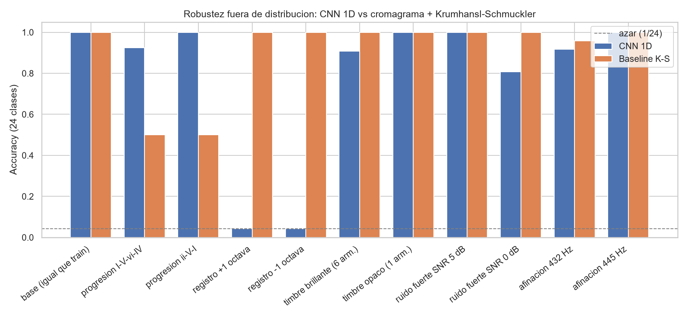

# Master of the Harmonica

> Clasificación de tonalidad musical en 24 clases con CNN 1D sobre audio crudo, y derivación determinística de la armónica blues en segunda posición.

**TP Final · Redes Neuronales y Deep Learning · Maestría en IA · Universidad de Palermo**

[](https://www.python.org/)
[](https://pytorch.org/)
[](https://colab.research.google.com/)
[](informe/informe_tp_final_redes_neuronales.pdf)

---

## El problema

Para improvisar en blues con armónica hay que resolver dos cosas: en qué tonalidad está la canción, y qué armónica tomar del estuche. Lo segundo no es la armónica de la canción: en *segunda posición* (cross-harp) se usa la que está una cuarta justa arriba.

Este proyecto automatiza la cadena completa: **entra un audio, sale qué armónica agarrar y un riff para arrancar.**

```
audio.mp3 → [CNN 1D] → "G maj" (conf 0.92) → [regla +5] → armónica en C + riff de celdas
```

La parte perceptual (estimar la tonalidad) la resuelve una red. La parte musical (`armónica = (tónica + 5) mod 12`) es determinística y no se aprende: implementarla como red sería agregarle error a algo exacto.

---

## Resultado principal (leer esto antes que nada)

El modelo alcanza **100 % de accuracy en el test sintético**. Ese número, solo, es engañoso.

**La línea de base sin redes (cromagrama + Krumhansl-Schmuckler) obtiene el mismo 100 %.** El benchmark está saturado y no discrimina entre métodos. Eso disparó una evaluación fuera de distribución, donde aparece el hallazgo real:

| Escenario | CNN 1D | Baseline K-S |
|---|---|---|
| Test sintético | 1,000 | 1,000 |
| Progresión armónica nueva (`I-V-vi-IV`) | **0,925** | 0,500 |
| Progresión armónica nueva (`ii-V-I`) | **1,000** | 0,500 |
| Ruido fuerte (SNR 0 dB) | 0,808 | 1,000 |
| **Transposición de 1 octava** | **0,042** | **1,000** |
| 5 audios generados fuera del entrenamiento (tonalidad conocida) | 0,800 | **1,000** |
| **Canciones reales: GiantSteps Key (20 temas)** | **0,100** | **0,450** |

La CNN **colapsa al nivel del azar (1/24 = 0,042) ante un cambio de octava**, mientras el método clásico no se inmuta. En **canciones reales** pasa lo mismo: sobre 20 temas de GiantSteps la red acierta 2 de 20 y el método clásico 9 de 20. En 11 de los 20 temas la red responde `A maj`, sin importar la canción.

El diagnóstico por barrido de semitonos explica por qué: al desplazar el audio **un semitono**, la red predice la etiqueta *transpuesta* el **91,7 %** de las veces y la correcta el **0 %**.

> **La red aprendió a detectar altura absoluta, no tonalidad.**

La causa no fue la arquitectura: fue el conjunto de datos. El generador sintético ubicaba cada tonalidad siempre en el mismo registro, lo que volvió "tonalidad" y "frecuencia absoluta" indistinguibles. El modelo tomó el atajo (*shortcut learning*) y el test, generado con el mismo sesgo, no podía detectarlo.

**Conclusión honesta: para esta tarea y con este diseño, la red no superó a la línea de base.** El valor del trabajo está en haberlo detectado, medido y explicado. El análisis completo y las correcciones propuestas están en el **[informe](informe/informe_tp_final_redes_neuronales.pdf)**.

<p align="center">
  
</p>

---

## Qué hay en este repositorio

```
├── informe/
│   ├── informe_tp_final_redes_neuronales.pdf                  ← informe completo (15 pág.)
│   ├── informe_tp_final_redes_neuronales.md                   ← fuente en Markdown
│   ├── md_a_pdf.py                  ← generador del PDF
│   └── figuras/                     ← figuras del informe
├── presentacion/
│   └── presentacion.pptx            ← slides para la defensa oral
├── experimentos/
│   ├── run_experimentos.py          ← entrenamiento + test + audio real
│   ├── run_robustez.py              ← 11 escenarios fuera de distribución
│   ├── run_diagnostico.py           ← barrido de semitonos (el hallazgo)
│   └── resultados/                  ← métricas .json, figuras .png, modelo .pt, giantsteps.csv/.json
├── TP_Final_Revisado_Profe_24Keys.ipynb   ← notebook principal (Colab)
├── TP_Final_Armonica_Blues_CNN1D.ipynb    ← primera versión (12 notas), antecedente
├── audios_prueba_final/             ← 5 audios generados de tonalidad conocida + MANIFEST
└── requirements.txt
```

---

## Reproducir

### Opción A — Colab (sin instalar nada)

Subir `TP_Final_Revisado_Profe_24Keys.ipynb` → entorno CPU o GPU T4 → *Reiniciar y ejecutar todo*.

### Opción B — Local

```bash
git clone https://github.com/vmdanguise/master-of-the-harmonica.git
cd master-of-the-harmonica
pip install -r requirements.txt

python experimentos/run_experimentos.py   # entrena y evalúa (~10 min en CPU)
python experimentos/run_robustez.py       # 11 escenarios OOD
python experimentos/run_diagnostico.py    # diagnóstico de transposición
python informe/md_a_pdf.py                # regenera el PDF
```

Los tres scripts escriben en `experimentos/resultados/`: `metricas.json`, `robustez.json`, `diagnostico.json`, las figuras `.png`, `cnn_vs_ks.csv` y el modelo `keycnn1d_best.pt`.

---

## Diseño experimental

### Entrada y salida (según revisión de cátedra)

- **Entra:** `WAV/MP3` → mono → 16 kHz → ventanas de 4 s normalizadas por pico. A la red entra **forma de onda cruda**: no entra MIDI ni cromagrama.
- **Sale:** tonalidad en **24 clases** (12 tónicas × mayor/menor) con confianza y Top-3; la armónica se deriva por regla.

### Modelo

`KeyCNN1D` — **80.968 parámetros**, entrada `(1, 64000)`, salida 24 logits.

| Bloque | Operación | Canales | Kernel |
|---|---|---|---|
| b1 | Conv1d(stride 8) + BN + ReLU + MaxPool(4) | 1 → 16 | 128 |
| b2 | Conv1d + BN + ReLU + MaxPool(4) | 16 → 32 | 16 |
| b3 | Conv1d + BN + ReLU + MaxPool(4) | 32 → 64 | 7 |
| b4 | Conv1d + BN + ReLU + MaxPool(4) | 64 → 128 | 5 |
| head | AdaptiveAvgPool1d(1) → 128 → 96 → 24 (dropout 0.3) | — | — |

Kernel inicial ancho (128 muestras ≈ 8 ms) para capturar periodicidad; `AdaptiveAvgPool1d` colapsa el tiempo porque la tonalidad es una propiedad global del fragmento.

**Entrenamiento:** CrossEntropy + Adam (`lr=1e-3`), 12 épocas, batch 32, semilla 42.

### Datos

- **Sintético (entrena):** progresiones `I-IV-V⁷-I` (mayor) / `i-iv-V⁷-i` (menor), 4 s @16 kHz, 3 armónicos + envolvente + micro-desafinación + ruido SNR 12–25 dB, generadas *on-the-fly*. `train 1920 / val 480 / test 480`, balanceado en 24 clases.
- **Canciones reales (solo evalúa):** [GiantSteps Key](https://github.com/GiantSteps/giantsteps-key-dataset) (604 fragmentos de 2 min de música electrónica de Beatport, tonalidad anotada en 24 clases, Knees et al. ISMIR 2015). El repositorio de anotaciones no declara licencia y los audios son previews de Beatport, por eso no se redistribuyen. El notebook baja 20 temas al azar (semilla 7) y verifica cada MP3 con md5. Los MP3 no se versionan; los resultados por tema están en `experimentos/resultados/giantsteps.csv` y `giantsteps.json`.
- **Audios generados de control (solo evalúa):** `audios_prueba_final/` contiene 5 audios **sintetizados por programa** (4 progresiones y un blues de 12 compases) con tonalidad conocida. No son grabaciones reales: sirven para probar la cadena completa con formatos distintos al de entrenamiento.
- **MP3 comercial:** *Pappo – Buscando un Amor*, como demostración, sin tonalidad anotada.

### Métricas

Accuracy en 24 clases (azar = 1/24) y **score estilo MIREX**, que da crédito parcial por errores musicalmente cercanos: exacto `1.0`, quinta `0.5`, relativa o modo cambiado `0.3`, resto `0.0`.

---

## Regla cross-harp

```python
armonica = (tonica + 5) % 12   # una cuarta justa arriba
```

Vale igual para mayor y menor (depende solo de la tónica).

| Canción | Armónica | | Canción | Armónica |
|---|---|---|---|---|
| C | F | | F# | B |
| C# | F# | | G | **C** |
| D | G | | G# | C# |
| D# | G# | | A | **D** |
| E | A | | A# | D# |
| F | A# | | B | E |

Técnica, sin teoría: **soplar** (echar aire), **aspirar** (tomar aire), **bending** (aspirar frenando el aire, el sonido lloradito del blues). La casa de la segunda posición es la **celda 2 aspirando**.

---

## Limitaciones conocidas

- **Transposición:** limitación principal, cuantificada arriba. La red no es invariante a la octava.
- **Ventana de 4 s:** no capta modulaciones dentro de un tema.
- **Blues mezcla mayor y menor** por diseño estético → `A maj` y `A min` son parcialmente ambiguos; por eso se reporta Top-3 y MIREX.
- **Brecha sintético → real:** sin batería, voz ni distorsión en el entrenamiento, el audio comercial queda fuera de distribución (confianza 0,245 en el MP3 de prueba).

## Trabajo futuro

Ordenado por impacto sobre la causa raíz identificada:

1. **Aumentación por pitch-shift** actualizando la etiqueta — rompe la correlación espuria entre tonalidad y altura absoluta.
2. **Randomizar la octava en el generador** — dos líneas de código, elimina el sesgo en el origen.
3. **Migrar a CQT/log-mel + CNN 2D** — sobre una CQT la transposición es una traslación, y la convolución 2D es equivariante a traslaciones: da por arquitectura la invariancia que hoy falta.
4. **Ampliar la evaluación de GiantSteps de 20 a los 604 temas**, para tener números con menos margen de error.

---

## Entorno

Los resultados salen de dos corridas, ambas con semilla fija `42` (`random`, `numpy`, `torch`, `cudnn.deterministic`):

| Corrida | Qué produce | Entorno |
|---|---|---|
| **Local, CPU** (`experimentos/`) | entrenamiento, test sintético, 11 escenarios OOD, barrido de semitonos, 5 audios generados | Python 3.12.10 · PyTorch 2.14.1 · librosa 1.0.0 · scikit-learn 1.9.1 · scipy 1.18.1 · numpy 2.5.3 |
| **Google Colab, GPU T4** (notebook desde cero) | reproduce entrenamiento y test sintético; **GiantSteps** y MP3 comercial | Python 3.13.15 · PyTorch 2.11.0 · librosa 0.11.0 · scikit-learn 1.6.1 · scipy 1.16.3 · numpy 2.1.3 |

**Sobre el MIREX de GiantSteps:** el notebook imprime `K-S mirex 0.54`; el valor correcto es **0,59**. Esa celda llama a `mirex(predicción, verdad)` con los argumentos invertidos y pierde el crédito de quinta en dos temas. `giantsteps.json` trae el valor recalculado sobre las mismas predicciones; la accuracy no cambia.

## Referencias

- Krumhansl & Kessler (1982). *Tracing the dynamic changes in perceived tonal organization...* Psychological Review 89(4).
- Knees et al. (2015). *Two data sets for tempo estimation and key detection in EDM.* ISMIR.
- Geirhos et al. (2020). *Shortcut learning in deep neural networks.* Nature Machine Intelligence 2(11).
- Géron (2019). *Hands-On Machine Learning*, cap. 10.

---

**Autor:** V. M. Danguise · Universidad de Palermo · 2026
