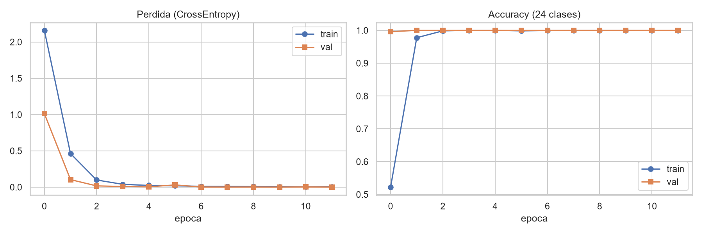
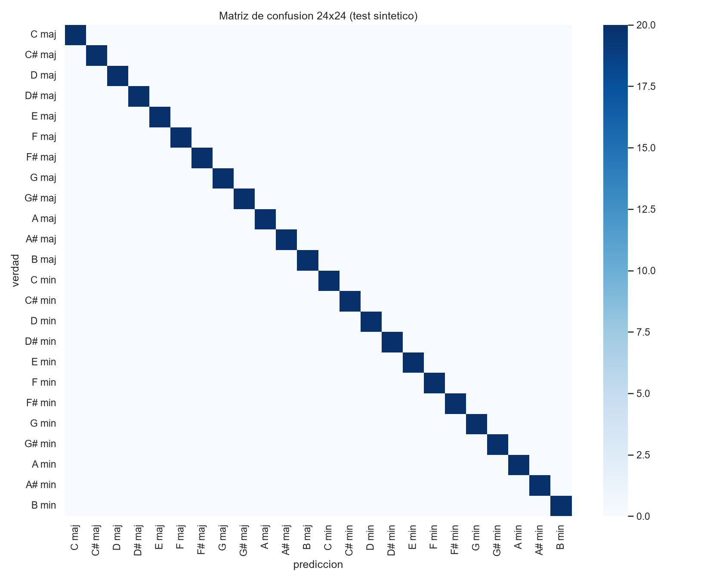
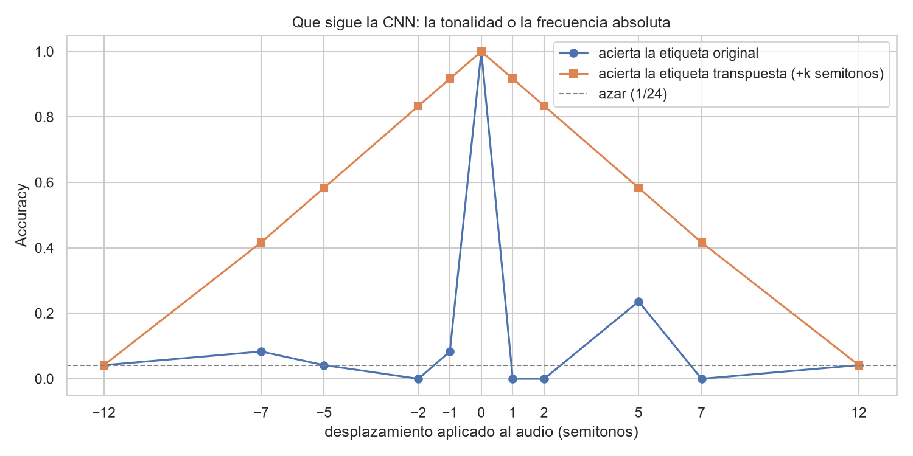

# Master of the Harmonica

## Clasificación de tonalidad musical en 24 clases con CNN 1D sobre audio crudo, y derivación determinística de armónica blues en segunda posición

**Trabajo Práctico Final**
**Materia:** Redes Neuronales y Deep Learning
**Carrera:** Maestría en Inteligencia Artificial
**Universidad:** Universidad de Palermo
**Autor:** V. M. Danguise
**Repositorio:** https://github.com/vmdanguise/master-of-the-harmonica
**Fecha:** octubre de 2026

---

## Resumen

Este trabajo aborda un problema concreto del músico de armónica: dada una canción, decidir qué armónica tomar del estuche para improvisar sobre ella. El problema se descompone en dos partes. La primera es un problema de aprendizaje: estimar la tonalidad de la canción a partir del audio. La segunda es determinística y se resuelve con una regla de teoría musical: en segunda posición (*cross-harp*), la armónica correcta está una cuarta justa por encima de la tónica de la canción, es decir `(tónica + 5) mod 12`.

Para la parte de aprendizaje se implementó `KeyCNN1D`, una red convolucional unidimensional de 80.968 parámetros que recibe audio crudo monofónico a 16 kHz en ventanas de 4 segundos (vectores de 64.000 muestras) y produce 24 logits correspondientes a las 24 tonalidades (12 tónicas × {mayor, menor}). La red se entrenó desde cero sobre un conjunto sintético de progresiones armónicas generado por procedimiento, y se comparó sistemáticamente contra una línea de base no neuronal clásica: cromagrama CQT correlacionado con los perfiles de Krumhansl-Kessler (K-S).

El resultado principal del trabajo **no es el que se esperaba, y es el aporte más valioso del informe**. La CNN alcanza 100 % de accuracy en el conjunto de test sintético, con score MIREX de 1.000. Sin embargo, la línea de base no neuronal alcanza exactamente el mismo 100 %. Esto revela que el benchmark sintético está saturado y no discrimina entre métodos: cualquier resultado medido únicamente sobre él es insuficiente para afirmar que la red aprendió algo útil.

Para resolver esa ambigüedad se diseñó un protocolo de evaluación fuera de distribución (OOD) con once escenarios de perturbación controlada. Allí la conclusión se invierte. La CNN mantiene buen desempeño frente a cambios de progresión armónica (92,5 % y 100 %), de timbre (90,8 %) y de ruido (80,8 % a SNR 0 dB), pero **colapsa a 4,2 % de accuracy —por debajo del azar relativo a la línea de base— cuando el audio se transpone una octava**, condición en la que el método clásico se mantiene en 100 %. Un experimento de diagnóstico con barrido fino en semitonos explica el mecanismo: al desplazar el audio un semitono, la red predice la etiqueta *transpuesta* en el 91,7 % de los casos y la etiqueta correcta en el 0 %. Es decir, la red no aprendió tonalidad, sino **altura absoluta**. Funcionó en test porque el generador sintético siempre ubicaba cada tonalidad en el mismo registro, lo que constituye un atajo estadístico (*shortcut learning*) que el conjunto de test, por construir con el mismo generador, no podía detectar.

Sobre audio real la jerarquía se confirma: en los cinco audios versionados de tonalidad conocida la CNN acierta 4 de 5 (80 %) frente a 5 de 5 (100 %) del método clásico, y falla precisamente en el caso de blues de 12 compases, el más relevante para la aplicación. En un MP3 comercial la confianza de la red cae a 0,236, señal de operación fuera de su dominio de entrenamiento.

La conclusión honesta del trabajo es que, para esta tarea y con este diseño, **la red neuronal no superó a la línea de base clásica**, y que el diseño del conjunto de datos —no la arquitectura— fue el factor limitante. El informe documenta el diagnóstico y propone la corrección concreta: representación invariante a transposición (CQT o log-mel) y aumentación por *pitch-shift*, que atacan directamente la causa raíz identificada.

---

## 1. Introducción y motivación

### 1.1 El problema práctico

La armónica diatónica es un instrumento construido en una tonalidad fija. Una armónica en C contiene cómodamente las notas de la escala de C; tocar sobre una canción en otra tonalidad exige tomar otra armónica. El armonicista de blues resuelve esto llevando un estuche con varias armónicas y eligiendo la adecuada para cada tema.

La elección no es trivial para el principiante por dos razones acumuladas. Primero, hay que identificar la tonalidad de la canción de oído. Segundo, la armónica que se usa en blues **no** es la de la tonalidad de la canción: se toca en *segunda posición* o *cross-harp*, una técnica en la que se usa una armónica cuya tónica está una cuarta justa por encima de la de la canción, porque así los *bendings* naturales del instrumento caen sobre las notas expresivas de la escala de blues.

El objetivo de este trabajo es automatizar la cadena completa: entra un archivo de audio, sale qué armónica tomar y un patrón de celdas para empezar a tocar.

### 1.2 Delimitación del problema según la revisión de cátedra

La propuesta inicial del trabajo era ambigua respecto de qué entraba y qué salía de la red. La cátedra señaló esa ambigüedad y pidió cuatro correcciones concretas, que estructuraron el trabajo final:

1. **Definir la entrada con precisión.** Se fijó: audio `WAV/MP3` → mono → 16 kHz → ventanas de 4 s normalizadas por pico. A la red entra la forma de onda cruda. No entra MIDI, no entra cromagrama, no entra ninguna representación pre-extraída. Esto es una decisión deliberada: se quiere evaluar si una CNN 1D puede aprender la estructura tonal directamente de la señal.
2. **Definir la salida con precisión.** Se fijó: clasificación en 24 clases (12 tónicas × 2 modos), con confianza y Top-3. La armónica **no** la predice la red: se deriva por regla determinística a partir de la tónica predicha. Separar lo aprendido de lo deducido evita atribuirle a la red mérito que corresponde a la teoría musical.
3. **Validar fuera de los datos sintéticos.** Como el entrenamiento es sintético, se exigió probar sobre canciones reales de tonalidad conocida.
4. **Incluir una línea de base sin redes.** Se exigió comparar contra un método clásico. Esta fue la indicación más productiva del trabajo: es la que permitió detectar que el benchmark sintético estaba saturado y que la red había aprendido un atajo.

### 1.3 Aporte del trabajo

El aporte no es una arquitectura nueva ni un resultado de estado del arte. Es un **estudio de validación**: muestra cómo una métrica de test perfecta (100 %) puede ocultar por completo que un modelo no aprendió la tarea pretendida, y cómo un protocolo de evaluación adecuado —línea de base más pruebas fuera de distribución— lo revela. Es, en esencia, una demostración práctica y reproducible de *shortcut learning* en audio.

---

## 2. Marco teórico

### 2.1 Tonalidad: 24 clases, no 12 notas

La primera versión de este trabajo clasificaba 12 notas cromáticas. Esto es incorrecto desde el punto de vista musical: una canción no está "en la nota A", está "en A mayor" o "en A menor", y la diferencia es audible y funcional. La tonalidad es el centro tonal más el modo.

`A mayor` y `A menor` comparten tónica pero difieren en la tercera (C# contra C natural) y en la sexta. Esa diferencia cambia por completo el carácter y, en nuestra aplicación, cambia qué notas de la armónica suenan bien. Por eso el espacio de salida se amplió a 24 clases: las 12 tónicas cromáticas (`C, C#, D, D#, E, F, F#, G, G#, A, A#, B`) cruzadas con los dos modos (`maj`, `min`).

Una consecuencia metodológica importante es que no todos los errores son igual de graves. Confundir `C maj` con `G maj` (su dominante, tonalidades vecinas que comparten seis de siete notas) es un error mucho más leve que confundir `C maj` con `F# min`. Esto motiva la métrica MIREX descrita más abajo.

### 2.2 La regla de segunda posición (cross-harp)

La armónica recomendada se obtiene con una única operación aritmética sobre la clase de altura de la tónica:

```
armónica = (tónica + 5) mod 12
```

Cinco semitonos es una cuarta justa. La regla depende únicamente de la tónica, no del modo, por lo que vale igual para mayor y menor. Ejemplos: canción en `G` (índice 7) → `(7+5) mod 12 = 0` → armónica en `C`; canción en `A` (índice 9) → `(9+5) mod 12 = 2` → armónica en `D`; canción en `E` (4) → armónica en `A` (9).

La tabla completa derivada de la regla es: C→F, C#→F#, D→G, D#→G#, E→A, F→A#, F#→B, G→C, G#→C#, A→D, A#→D#, B→E.

No hay nada que aprender acá, y es correcto que así sea: implementar esto como una capa de red sería añadir error a algo exacto. La red se ocupa solo de la parte genuinamente perceptual.

### 2.3 Redes convolucionales unidimensionales sobre audio crudo

Una convolución 1D desliza un kernel de longitud `k` a lo largo del eje temporal de la señal. Cada kernel aprende un patrón local de forma de onda; al compartirse a lo largo de todo el eje, el patrón se detecta sin importar en qué instante ocurre (equivarianza a traslación temporal).

Elementos del diseño empleado:

- **Kernel ancho en la primera capa (128 muestras ≈ 8 ms a 16 kHz).** Un kernel debe abarcar al menos un período de la frecuencia que quiere detectar. Para una nota grave de 65 Hz el período es ≈ 15,4 ms; 8 ms permite capturar parcialmente periodicidades de frecuencias medias y bajas. La primera capa actúa, en efecto, como un banco de filtros aprendido en lugar de impuesto por una FFT.
- **Stride y MaxPool.** El stride 8 inicial y los cuatro `MaxPool1d(4)` reducen la resolución temporal progresivamente (64.000 → 8.000 → 2.000 → 500 → 125 → 31), lo que aporta invariancia a pequeños desplazamientos y mantiene el costo computacional manejable en CPU.
- **BatchNorm + ReLU.** Normalización por lote para estabilizar la escala de activaciones entre capas y acelerar la convergencia; ReLU como no linealidad.
- **`AdaptiveAvgPool1d(1)`.** Colapsa el eje temporal restante en un único vector de 128 dimensiones promediando. Esto hace que la decisión dependa de la evidencia acumulada en toda la ventana y no de un instante particular, lo cual es apropiado: la tonalidad es una propiedad global del fragmento.

**Punto crítico, central para los resultados de este trabajo:** esta arquitectura es equivariante a traslación *temporal*, pero **no es invariante a traslación en frecuencia**. Un desplazamiento de altura (transposición) no es una traslación en el dominio temporal: es un escalado del eje temporal, que cambia la forma de onda de modo que los kernels aprendidos ya no la reconocen. Esta limitación arquitectónica es exactamente la que los experimentos de la sección 6 ponen en evidencia.

### 2.4 Línea de base: cromagrama y perfiles de Krumhansl-Schmuckler

El método clásico de estimación de tonalidad, previo al aprendizaje profundo, procede en dos pasos:

1. **Cromagrama.** Se calcula una transformada de Q constante (CQT) y se agrupa la energía en 12 bins, uno por clase de altura, sumando todas las octavas. Promediando sobre el tiempo se obtiene un vector `c` de 12 dimensiones que describe cuánta energía tuvo cada una de las 12 notas en el fragmento. **Por construcción, el cromagrama colapsa la información de octava**: C2, C4 y C6 contribuyen al mismo bin.
2. **Correlación con perfiles.** Krumhansl y Kessler midieron experimentalmente, con oyentes humanos, la estabilidad percibida de cada nota dentro de una tonalidad. Esos perfiles son `MAJ = [6.35, 2.23, 3.48, 2.33, 4.38, 4.09, 2.52, 5.19, 2.39, 3.66, 2.29, 2.88]` y `MIN = [6.33, 2.68, 3.52, 5.38, 2.60, 3.53, 2.54, 4.75, 3.98, 2.69, 3.34, 3.17]`. Se rotan los dos perfiles a las 12 tónicas posibles (24 candidatos), se calcula la correlación de Pearson de cada uno contra `c`, y gana el de mayor `r`.

Esta línea de base cumple dos funciones. Como referencia de calidad, fija el umbral que la red debe superar para justificar su existencia. Y como instrumento de diagnóstico, su invariancia estructural a la octava la convierte en el control perfecto para aislar el problema de la CNN.

### 2.5 Métricas

- **Accuracy en 24 clases.** Proporción de aciertos exactos. Línea de azar: 1/24 ≈ 4,2 %.
- **Score ponderado estilo MIREX.** Otorga crédito parcial por errores musicalmente cercanos: acierto exacto = 1,0; quinta del mismo modo = 0,5; relativa mayor/menor o misma tónica con modo cambiado = 0,3; cualquier otro error = 0,0. Esta métrica es la estándar en la comunidad de recuperación de información musical y es más informativa que la accuracy pura.
- **Accuracy de tónica y de modo por separado.** Permiten localizar si el error está en identificar el centro tonal o en distinguir mayor de menor.

---

## 3. Datos

### 3.1 Conjunto sintético de entrenamiento

No existe un conjunto de datos etiquetado por tonalidad que sea liviano, de licencia clara y descargable sin fricción, por lo que se optó por generación procedural. Cada ejemplo son 4 segundos a 16 kHz (64.000 muestras) que contienen una progresión armónica completa de cuatro acordes de 1 segundo cada uno:

- **Modo mayor:** `I – IV – V⁷ – I`
- **Modo menor:** `i – iv – V⁷ – i` (con V mayor, como en la menor armónica, que es la práctica real)

La decisión de sintetizar **progresiones y no tonos puros** es deliberada y corrige la primera versión del trabajo. La tonalidad es una relación entre notas; un tono aislado no tiene tonalidad. Entrenar con acordes funcionales en progresión obliga al modelo a considerar el contexto.

Cada acorde se construye sumando sus notas (tríadas `[0,4,7]` mayor, `[0,3,7]` menor, tétradas `[0,4,7,10]` para el grado V), y cada nota se sintetiza como fundamental más dos armónicos con amplitudes `[1.0, 0.4, 0.18]`, fase inicial aleatoria, envolvente de ataque (20 ms) y caída (80 ms), y micro-desafinación de ±0,4 % para evitar que las sumas sean exactas.

Finalmente se añade ruido blanco con relación señal-ruido muestreada uniformemente entre 12 y 25 dB, y se normaliza por pico a 0,9.

**Particiones:** 80 ejemplos por clase para entrenamiento (1.920), 20 para validación (480) y 20 para test (480), perfectamente balanceadas en las 24 clases. La generación es *on-the-fly* dentro del `Dataset` de PyTorch, lo que evita materializar gigabytes en RAM. Validación y test usan `RandomState` con semilla fija por índice, de modo que son determinísticos y comparables entre corridas; entrenamiento usa azar libre, lo que actúa como aumentación implícita.

### 3.2 Limitación crítica del generador (identificada *a posteriori*)

El generador fija el registro: la fundamental de cada tonalidad se ubica siempre en la misma octava (`BASE_F[tónica] / 2`, es decir octava 3). En consecuencia, **en todo el conjunto —entrenamiento, validación y test— cada tonalidad aparece siempre en el mismo rango de frecuencias absolutas**.

Esto crea una correlación espuria perfecta entre "tonalidad" y "altura absoluta". Un modelo puede resolver el conjunto completo aprendiendo únicamente a detectar frecuencias absolutas, sin construir ninguna noción de relación intervalar. Y como el test comparte el sesgo del generador, el test no puede detectarlo. La sección 6 muestra que esto es precisamente lo que ocurrió.

### 3.3 Audio real de evaluación

Se versionaron en el repositorio cinco audios de tonalidad conocida, a 16 kHz mono, usados **solo para evaluación** (nunca para entrenar):

| Archivo | Tonalidad verdadera | Contenido |
|---|---|---|
| `test_C_maj_I-IV-V-I.wav` | C maj | progresión I-IV-V-I |
| `test_G_maj_I-IV-V-I.wav` | G maj | progresión I-IV-V-I |
| `test_E_maj_I-IV-V-I.wav` | E maj | progresión I-IV-V-I |
| `test_A_min_i-iv-V-i.wav` | A min | progresión i-iv-V-i |
| `demo_blues_A_12bar_key-A-maj.wav` | A maj | blues de 12 compases, 24 s, walking bass |

Adicionalmente se incluye un MP3 comercial (*Pappo – Buscando un Amor*) como prueba de dominio totalmente abierto, y el notebook implementa la descarga automática de un subconjunto de **GiantSteps Key** (604 previews de 2 minutos, 24 tonalidades, Knees et al., ISMIR 2015), con verificación md5 contra el espejo de JKU y semilla fija, también solo para evaluación. Los MP3 descargados no se versionan.

---

## 4. Arquitectura e implementación

### 4.1 `KeyCNN1D`

| Bloque | Operación | Canales | Kernel | Stride | Salida temporal |
|---|---|---|---|---|---|
| entrada | — | 1 | — | — | 64.000 |
| b1 | Conv1d + BN + ReLU + MaxPool(4) | 1 → 16 | 128 | 8 | 2.000 |
| b2 | Conv1d + BN + ReLU + MaxPool(4) | 16 → 32 | 16 | 1 | 500 |
| b3 | Conv1d + BN + ReLU + MaxPool(4) | 32 → 64 | 7 | 1 | 125 |
| b4 | Conv1d + BN + ReLU + MaxPool(4) | 64 → 128 | 5 | 1 | 31 |
| gap | AdaptiveAvgPool1d(1) | 128 | — | — | 1 |
| head | Flatten → Linear(128,96) → ReLU → Dropout(0.3) → Linear(96,24) | — | — | — | 24 |

**Total: 80.968 parámetros.** El modelo es deliberadamente pequeño para que entrene en CPU en Colab gratuito en pocos minutos.

La progresión de kernels (128 → 16 → 7 → 5) sigue una lógica de granularidad decreciente: la primera capa necesita una ventana amplia para capturar periodicidad; las posteriores, operando sobre representaciones ya submuestreadas, refinan patrones con kernels cortos.

### 4.2 Entrenamiento

- **Pérdida:** `CrossEntropyLoss` (clasificación multiclase de 24 vías)
- **Optimizador:** Adam, learning rate `1e-3`
- **Épocas:** 12 · **Batch size:** 32
- **Selección de modelo:** se conserva el estado con mejor accuracy de validación
- **Reproducibilidad:** semilla 42 en `random`, `numpy` y `torch`; `cudnn.deterministic = True`

### 4.3 Entorno

Python 3.12.10, PyTorch 2.14.1 (CPU), librosa 1.0.0, scikit-learn 1.9.1, scipy 1.18.1, seaborn 0.13.2, numpy 2.5.3. Toda la ejecución reportada se hizo en CPU.

---

## 5. Resultados en distribución

### 5.1 Entrenamiento

| Época | Pérdida train | Acc train | Pérdida val | Acc val |
|---|---|---|---|---|
| 1 | 2,1608 | 0,522 | 1,0141 | 0,996 |
| 2 | 0,4630 | 0,978 | 0,1039 | **1,000** |
| 3 | 0,0989 | 0,998 | 0,0174 | 1,000 |
| 4 | 0,0392 | 1,000 | 0,0095 | 1,000 |
| 6 | 0,0186 | 0,998 | 0,0309 | 1,000 |
| 8 | 0,0102 | 1,000 | 0,0008 | 1,000 |
| 10 | 0,0064 | 1,000 | 0,0005 | 1,000 |
| 12 | 0,0066 | 0,999 | 0,0009 | 1,000 |



La red alcanza 99,6 % de accuracy de validación **en la primera época** y 100 % en la segunda. La pérdida de validación cae a 9×10⁻⁴. Una convergencia tan inmediata en un problema de 24 clases es, en retrospectiva, la primera señal de alarma: indica que la tarea tal como está planteada es trivial, no que el modelo sea excelente.

### 5.2 Test sintético

| Métrica | CNN 1D | Baseline K-S |
|---|---|---|
| Accuracy (24 clases) | **1,000** | **1,000** |
| Score MIREX | **1,000** | **1,000** |
| Accuracy de tónica | 1,000 | — |
| Accuracy de modo | 1,000 | — |



La matriz de confusión de 24×24 es perfectamente diagonal: 480 de 480 aciertos, sin un solo error en ninguna de las 24 clases.

### 5.3 Primera conclusión: el benchmark no sirve

Si el informe terminara acá, reportaría "100 % de accuracy" y parecería un éxito rotundo. **Pero la línea de base no neuronal obtiene exactamente el mismo 100 %.** El método clásico, que no tiene parámetros entrenables y cuyos coeficientes provienen de experimentos psicoacústicos de los años ochenta, resuelve el conjunto igual de bien que la red.

De esto se siguen dos conclusiones inmediatas:

1. **El conjunto de test sintético está saturado y carece de poder discriminativo.** No puede ordenar métodos ni, por lo tanto, sustentar ninguna afirmación sobre la calidad de la red.
2. **No hay evidencia de que la red haya aportado valor.** El criterio que fijó la cátedra —"si la CNN no supera la línea de base, no agregó valor"— no se cumple.

Esto es exactamente para lo que sirve exigir una línea de base, y justifica el resto del trabajo: hay que buscar las métricas que sí discriminen.

---

## 6. Resultados fuera de distribución: el hallazgo principal

### 6.1 Protocolo

Se diseñaron once escenarios que perturban una dimensión del audio a la vez, manteniendo la tonalidad verdadera inalterada. Ninguno de ellos estuvo presente en el entrenamiento (excepto el escenario base, que es el control). Se evaluaron 120 ejemplos por escenario (5 por clase × 24 clases), con semillas fijas, y se midió tanto la CNN como la línea de base.

### 6.2 Resultados

| Escenario | CNN acc | CNN MIREX | K-S acc | K-S MIREX |
|---|---|---|---|---|
| base (igual que entrenamiento) | 1,000 | 1,000 | 1,000 | 1,000 |
| progresión I-V-vi-IV | 0,925 | 0,938 | 0,500 | 0,650 |
| progresión ii-V-I | 1,000 | 1,000 | 0,500 | 0,750 |
| **registro +1 octava** | **0,042** | **0,183** | **1,000** | **1,000** |
| **registro −1 octava** | **0,042** | **0,106** | **1,000** | **1,000** |
| timbre brillante (6 armónicos) | 0,908 | 0,926 | 1,000 | 1,000 |
| timbre opaco (1 armónico) | 1,000 | 1,000 | 1,000 | 1,000 |
| ruido fuerte SNR 5 dB | 1,000 | 1,000 | 1,000 | 1,000 |
| ruido fuerte SNR 0 dB | 0,808 | 0,838 | 1,000 | 1,000 |
| afinación 432 Hz | 0,917 | 0,917 | 0,958 | 0,958 |
| afinación 445 Hz | 1,000 | 1,000 | 1,000 | 1,000 |


### 6.3 Lectura de los resultados

Hay tres observaciones, y la tercera es el núcleo del trabajo.

**La CNN es genuinamente mejor en algo.** Frente a progresiones armónicas no vistas, la red mantiene 92,5 % y 100 %, mientras la línea de base cae a 50 %. Esto tiene sentido: los perfiles de Krumhansl-Kessler asumen una distribución típica de energía por nota, y una progresión como `I-V-vi-IV` altera esa distribución lo suficiente para confundirlos. La red, al mirar la señal completa, tolera mejor el cambio de contexto funcional. Es un resultado real y a favor del enfoque neuronal.

**La CNN es razonablemente robusta a timbre, ruido y afinación.** Degrada suavemente (90,8 % con timbre brillante, 80,8 % a SNR 0 dB, 91,7 % a 432 Hz), lo cual es un comportamiento sano.

**La CNN colapsa por completo ante un cambio de octava.** Pasa de 1,000 a **0,042**, que es exactamente 1/24, el nivel del azar. En la misma condición, la línea de base se mantiene en 1,000 sin degradación alguna. La asimetría es total y no admite interpretación benévola: el modelo pierde absolutamente toda su capacidad.

Musicalmente, una canción en C mayor sigue estando en C mayor si se la toca una octava más arriba. La tonalidad es invariante a la octava. Que el modelo pierda el 95,8 % de su accuracy ante una transformación que no cambia la etiqueta verdadera significa que **lo que el modelo usa para decidir no es la tonalidad**.

### 6.4 Diagnóstico: la red aprendió altura absoluta

Para identificar el mecanismo del fallo se hizo un barrido fino de transposición. Se desplazó el audio entre −12 y +12 semitonos y se midió dos cosas: con qué frecuencia la red predice la etiqueta original, y con qué frecuencia predice la etiqueta *transpuesta* (la tónica original desplazada los mismos `k` semitonos).

| Desplazamiento | Acierta etiqueta original | Predice etiqueta transpuesta |
|---|---|---|
| −12 st | 0,042 | 0,042 |
| −7 st | 0,083 | 0,417 |
| −5 st | 0,042 | 0,583 |
| −2 st | 0,000 | 0,833 |
| −1 st | 0,083 | **0,917** |
| 0 st | 1,000 | 1,000 |
| +1 st | 0,000 | **0,917** |
| +2 st | 0,000 | 0,833 |
| +5 st | 0,236 | 0,583 |
| +7 st | 0,000 | 0,417 |
| +12 st | 0,042 | 0,042 |



El patrón es inequívoco. Al desplazar el audio **un semitono**, la red acierta la etiqueta original el **0 %** de las veces, pero predice la etiqueta transpuesta el **91,7 %** de las veces. La red está siguiendo la frecuencia absoluta con precisión de semitono. No es que esté confundida: está midiendo exactamente lo que aprendió a medir, que es altura, no tonalidad.

El seguimiento se degrada al aumentar el desplazamiento (83,3 % a 2 semitonos, 58,3 % a 5, 41,7 % a 7) porque el desplazamiento también deforma el timbre y el registro se aleja del rango visto. A ±12 semitonos ambas curvas caen a 0,042: a una octava completa de distancia el modelo ya no reconoce nada y sus salidas son indistinguibles del azar.

El análisis de la distribución de predicciones bajo desplazamiento de octava completa la imagen. Con el audio una octava arriba, de 120 predicciones la red usa solo **7 clases distintas de las 24**, y concentra el 52,5 % en una sola (`A# min`). Una octava abajo, usa 9 clases y concentra el 70,8 % en `C maj`. El modelo no distribuye sus errores: colapsa a unos pocos atractores, el comportamiento típico de una red operando fuera del dominio donde sus features tienen sentido.

**Interpretación.** El generador sintético ubicaba cada tonalidad siempre en la misma octava (sección 3.2). Eso hizo que "tonalidad" y "banda de frecuencias absolutas" fueran predictores perfectamente equivalentes dentro del conjunto de datos. Ante dos soluciones equivalentes en los datos, el descenso por gradiente encontró la más simple de representar con convoluciones temporales: detectar frecuencias absolutas. Nunca necesitó construir relaciones intervalares, que es lo que realmente define una tonalidad.

Esto es un caso de libro de **shortcut learning**: el modelo explota una regularidad espuria del conjunto de datos que lo resuelve perfectamente pero no se generaliza, y el test —generado con el mismo sesgo— es incapaz de detectarlo. Y conecta directamente con el análisis arquitectónico de la sección 2.3: la CNN 1D sobre forma de onda cruda no tiene ningún mecanismo estructural que la empuje hacia la invariancia a transposición, mientras el cromagrama la tiene por construcción. La línea de base no es "mejor": es que su sesgo inductivo es el correcto para esta tarea.

---

## 7. Resultados sobre audio real

### 7.1 Audios de tonalidad conocida

| Archivo | Verdad | CNN (conf.) | K-S (r) | CNN ok | K-S ok |
|---|---|---|---|---|---|
| `test_C_maj_I-IV-V-I.wav` | C maj | C maj (0,95) | C maj (0,96) | ✓ | ✓ |
| `test_G_maj_I-IV-V-I.wav` | G maj | G maj (0,92) | G maj (0,97) | ✓ | ✓ |
| `test_E_maj_I-IV-V-I.wav` | E maj | E maj (0,98) | E maj (0,97) | ✓ | ✓ |
| `test_A_min_i-iv-V-i.wav` | A min | A min (0,96) | A min (0,90) | ✓ | ✓ |
| `demo_blues_A_12bar_key-A-maj.wav` | A maj | **C maj (0,75)** | A maj (0,84) | ✗ | ✓ |
| **Resumen** | | **acc 0,80 · MIREX 0,80** | **acc 1,00 · MIREX 1,00** | **4/5** | **5/5** |

La CNN acierta los cuatro audios cuyo formato coincide con el del entrenamiento (progresiones de cuatro acordes), con confianzas altas (0,92–0,98). Falla en el único que se aparta de ese formato: el blues de 12 compases, que tiene 24 segundos, solo walking bass sin acordes completos, y un registro más grave. La red predice `C maj` con 0,75 de confianza —un error alto en confianza, que es el tipo de error más problemático— y obtiene MIREX 0,0: `C maj` no guarda relación de quinta ni de relativa con `A maj`.

El caso es doblemente significativo porque **el blues es precisamente el género de la aplicación**. El sistema falla en su caso de uso central. Y es coherente con el diagnóstico: el bajo en registro grave desplaza la energía fuera de la banda donde la red aprendió a buscar `A`.

### 7.2 MP3 comercial

Sobre *Pappo – Buscando un Amor*:

- **CNN:** `A min`, confianza **0,236**. Top-3: `A min` (0,236), `F maj` (0,129), `A# maj` (0,113).
- **K-S:** `E min`, `r = 0,684`.

Sin anotación de referencia verificada no se puede declarar un ganador, pero la confianza de 0,236 de la red es informativa: con una distribución casi plana entre las tres primeras clases, el modelo está indicando que no sabe. La música real tiene batería, voz, guitarras distorsionadas y reverberación, nada de lo cual existe en el conjunto sintético. Es el comportamiento esperable de un modelo operando muy lejos de su distribución de entrenamiento, y la baja confianza es, al menos, una señal honesta y aprovechable como criterio de rechazo.

### 7.3 Cadena completa de aplicación

A modo de demostración del producto final, para el audio `test_G_maj`:

```
================================================
   EL AS DE LA ARMONICA
================================================
Tonalidad CNN : G maj (conf 0.92)
Baseline K-S  : G maj (r=0.97)
Agarrá        : ARMONICA EN C  (canción G, +5 semitonos)
   1. celda 2 aspirando (casa)
   2. celda 3 aspirando con bending (lloradito)
   3. celda 4 aspirando
   4. celda 4 soplando
   5. celda 4 aspirando
   6. celda 3 aspirando con bending
   7. celda 2 aspirando
Tip: casa = celda 2 aspirando.
================================================
```

La derivación `G → C` es exacta por construcción: una vez acertada la tónica, la parte de teoría musical no introduce error.

---

## 8. Discusión

### 8.1 Respuesta a la pregunta del trabajo

**¿Aportó valor la red neuronal frente al método clásico?** Para esta tarea y con este diseño, **no**.

El balance consolidado es: empate en test sintético (1,000 contra 1,000, benchmark saturado y por tanto no informativo); ventaja de la CNN en generalización a progresiones armónicas nuevas (92,5–100 % contra 50 %); ventaja decisiva de la línea de base en invariancia a octava (100 % contra 4,2 %); y ventaja de la línea de base en audio real (5/5 contra 4/5).

El único eje donde la red gana es real pero no compensa un fallo que la vuelve inutilizable ante una transformación musicalmente irrelevante.

### 8.2 La causa fue el diseño de los datos, no la arquitectura

Es importante atribuir correctamente el fallo. El problema no fue el número de parámetros, la profundidad, el learning rate ni las épocas. Ninguna búsqueda de hiperparámetros habría resuelto esto, porque **el conjunto de datos permitía resolver la tarea con un atajo y el modelo lo tomó**. Mientras tonalidad y altura absoluta sean indistinguibles en los datos, no hay razón para que la optimización prefiera la representación musicalmente correcta.

De aquí la lección metodológica central del trabajo: el diseño del conjunto de datos y del protocolo de evaluación determinó el resultado mucho más que cualquier decisión de arquitectura.

### 8.3 Lecciones metodológicas

1. **Una métrica de test perfecta no es evidencia de aprendizaje.** El 100 % de accuracy fue el síntoma del problema, no la prueba de la solución. Una convergencia a 99,6 % en la primera época debería leerse como sospecha, no como logro.
2. **La línea de base no es un trámite del informe: es el instrumento de diagnóstico.** Sin el 100 % de K-S, el empate habría pasado por victoria. Toda la investigación posterior se desencadenó por esa comparación.
3. **El test tomado del mismo generador que el entrenamiento no mide generalización.** Mide consistencia del generador. Detectar *shortcut learning* exige evaluar fuera de distribución, perturbando dimensiones que no cambian la etiqueta.
4. **Conviene razonar sobre el sesgo inductivo antes de entrenar.** El análisis de la sección 2.3 —que una CNN 1D sobre onda cruda es equivariante en tiempo pero no en frecuencia— predecía el fallo. Estaba disponible *a priori*.

### 8.4 Limitaciones

- **Transposición:** limitación principal, documentada y cuantificada.
- **Ventana de 4 s:** no capta modulaciones; una canción que cambia de tonalidad se evalúa por fragmentos sin integración global.
- **Ambigüedad mayor/menor en blues:** el blues mezcla la tercera mayor y menor por diseño estético, por lo que `A maj` y `A min` son parcialmente ambiguos en el género. Esto motiva reportar Top-3 y MIREX en lugar de solo accuracy.
- **Brecha de dominio sintético-real:** sin percusión, voz, distorsión ni reverberación en el entrenamiento, el audio comercial queda fuera de distribución.
- **Volumen de evaluación real:** cinco audios versionados son pocos para conclusiones estadísticas robustas; la evaluación sobre GiantSteps está implementada pero su ejecución depende de la disponibilidad del espejo.

---

## 9. Trabajo futuro

Las propuestas se ordenan por relación entre impacto esperado y esfuerzo, y atacan la causa raíz identificada.

**1. Aumentación por pitch-shift (impacto alto, esfuerzo bajo).** Transponer cada ejemplo aleatoriamente entre −12 y +12 semitonos **actualizando la etiqueta en consecuencia**. Esto rompe la correlación espuria entre tonalidad y altura absoluta: la misma banda de frecuencias pasa a corresponder a distintas tonalidades, y el atajo deja de funcionar. Es la corrección más directa al diagnóstico y debería ser el primer paso.

**2. Randomizar el registro en el generador (impacto alto, esfuerzo muy bajo).** Muestrear la octava base al azar en lugar de fijarla. Son dos líneas de código en `prog_key` y elimina el sesgo en el origen.

**3. Representación invariante a transposición (impacto alto, esfuerzo medio).** Reemplazar la entrada de onda cruda por CQT o log-mel y usar una CNN 2D. Sobre una CQT, una transposición es una traslación del eje de frecuencia, y una convolución 2D es equivariante a traslaciones: la invariancia se obtiene por arquitectura en lugar de tener que aprenderse. Equivale a darle al modelo el sesgo inductivo que hace funcionar al cromagrama, conservando la capacidad de aprender.

**4. Evaluación sistemática en GiantSteps (impacto alto, esfuerzo medio).** Correr el protocolo completo sobre los 604 temas anotados y reportar accuracy y MIREX contra la línea de base, lo que daría una medición sólida sobre música real.

**5. Entrenar con audio real o con mezclas más ricas (impacto medio-alto, esfuerzo alto).** Incorporar percusión, voz, distorsión y reverberación, o directamente entrenar sobre GiantSteps con validación cruzada.

**6. Agregación temporal e integración con la línea de base (impacto medio, esfuerzo bajo).** Votación sobre ventanas con ponderación por confianza para manejar modulaciones, y un esquema híbrido que use el cromagrama como *prior* o rechace predicciones de baja confianza delegando en el método clásico.

---

## 10. Conclusiones

Se implementó y evaluó un sistema completo que estima la tonalidad de una canción en 24 clases a partir de audio crudo con una CNN 1D de 80.968 parámetros, y deriva la armónica blues de segunda posición mediante la regla determinística `(tónica + 5) mod 12`. La cadena funciona de punta a punta, es reproducible con semilla fija y corre en CPU en Colab gratuito.

El resultado medido sobre el test sintético es 100 % de accuracy y MIREX 1,000. Ese resultado, aislado, es engañoso. La línea de base no neuronal —cromagrama más perfiles de Krumhansl-Schmuckler— obtiene idéntico 100 %, lo que prueba que el benchmark está saturado y no discrimina.

La evaluación fuera de distribución revela el verdadero comportamiento del modelo. La CNN generaliza mejor que el método clásico a progresiones armónicas nuevas (92,5–100 % contra 50 %), pero colapsa a 4,2 % —el nivel del azar— ante una transposición de octava, condición en la que la línea de base conserva 100 %. El diagnóstico por barrido de semitonos identifica el mecanismo con precisión: al desplazar el audio un semitono, la red predice la etiqueta transpuesta en el 91,7 % de los casos y la correcta en el 0 %. **La red aprendió a detectar altura absoluta, no tonalidad.** La causa es que el generador sintético ubicaba cada tonalidad siempre en el mismo registro, haciendo que ambos conceptos fueran indistinguibles en los datos.

Sobre audio real la línea de base también se impone (5/5 contra 4/5), y la CNN falla justamente en el blues de 12 compases, el caso de uso central de la aplicación.

La respuesta a la pregunta que fijó la cátedra es, por lo tanto, negativa y está respaldada por evidencia: con este diseño la red no superó a la línea de base. El valor del trabajo está en haberlo detectado, medido y explicado en lugar de reportar el 100 % inicial. El factor determinante fue el diseño del conjunto de datos y del protocolo de evaluación, no la arquitectura, y las correcciones propuestas —randomizar el registro, aumentar con pitch-shift y migrar a una representación CQT con convoluciones 2D— se derivan directamente del diagnóstico y son verificables.

---

## Referencias

1. Krumhansl, C. L., & Kessler, E. J. (1982). *Tracing the dynamic changes in perceived tonal organization in a spatial representation of musical keys*. Psychological Review, 89(4), 334–368.
2. Krumhansl, C. L. (1990). *Cognitive Foundations of Musical Pitch*. Oxford University Press.
3. Knees, P., Faraldo, Á., Herrera, P., Vogl, R., Böck, S., Hörschläger, F., & Le Goff, M. (2015). *Two data sets for tempo estimation and key detection in electronic dance music*. ISMIR 2015.
4. Géron, A. (2019). *Hands-On Machine Learning with Scikit-Learn, Keras and TensorFlow*, cap. 10. O'Reilly.
5. Goodfellow, I., Bengio, Y., & Courville, A. (2016). *Deep Learning*. MIT Press.
6. Geirhos, R., Jacobsen, J.-H., Michaelis, C., Zemel, R., Brendel, W., Bethge, M., & Wichmann, F. A. (2020). *Shortcut learning in deep neural networks*. Nature Machine Intelligence, 2(11), 665–673.
7. McFee, B. et al. (2015). *librosa: Audio and music signal analysis in Python*. SciPy 2015.
8. Dai, W., Dai, C., Qu, S., Li, J., & Das, S. (2017). *Very deep convolutional neural networks for raw waveforms*. ICASSP 2017.

---

## Anexo A — Reproducción

```bash
git clone https://github.com/vmdanguise/master-of-the-harmonica.git
cd master-of-the-harmonica
pip install -r requirements.txt

python experimentos/run_experimentos.py   # entrenamiento + test + audio real
python experimentos/run_robustez.py       # 11 escenarios fuera de distribución
python experimentos/run_diagnostico.py    # barrido de semitonos
```

Salidas en `experimentos/resultados/`: `metricas.json`, `robustez.json`, `diagnostico.json`, `curvas.png`, `matriz_confusion.png`, `robustez.png`, `diagnostico_octava.png`, `cnn_vs_ks.csv`, `keycnn1d_best.pt`.

Alternativamente, subir `TP_Final_Revisado_Profe_24Keys.ipynb` a Google Colab y ejecutar todo.

**Entorno de la corrida reportada:** Python 3.12.10, PyTorch 2.14.1+cpu, librosa 1.0.0, scikit-learn 1.9.1, scipy 1.18.1, seaborn 0.13.2, numpy 2.5.3, CPU, semilla 42.

## Anexo B — Tabla cross-harp completa

| Canción | Armónica (2ª pos.) | | Canción | Armónica (2ª pos.) |
|---|---|---|---|---|
| C | F | | F# | B |
| C# | F# | | G | C |
| D | G | | G# | C# |
| D# | G# | | A | D |
| E | A | | A# | D# |
| F | A# | | B | E |

Regla: `armónica = (tónica + 5) mod 12`. Independiente del modo.
